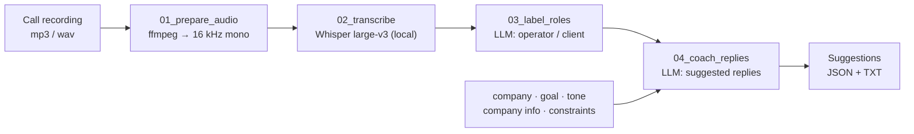
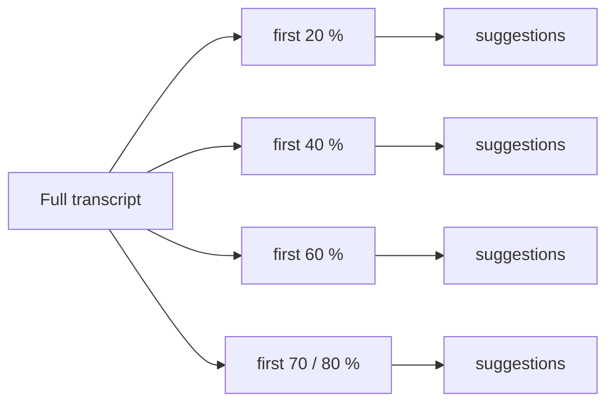

# HelperCaller — AI sales-call coach

A speech-recognition + LLM pipeline that helps sales operators run conversations with clients. It transcribes a call, labels who is speaking and suggests what the operator could say next, taking into account the company's goal, tone of voice, product information and constraints (what may not be promised).

## Pipeline



| Step | Script | What it does |
|---|---|---|
| 1 | `01_prepare_audio.py` | converts audio to 16 kHz mono WAV with ffmpeg |
| 2 | `02_transcribe.py` | local speech-to-text with Whisper (`large-v3` by default), segments with timestamps |
| 3 | `03_label_roles.py` | labels speaker roles (operator / client) with an OpenAI model |
| 4 | `04_coach_replies.py` | generates suggested replies for the operator from the dialogue tail |
| — | `run_pipeline_slices.py` | runs the full pipeline and replays coaching on 20 / 40 / 60 / 70 / 80 % of the call |

## Simulating real-time coaching

`run_pipeline_slices.py` cuts the transcript into growing prefixes and asks the coach for suggestions at each point — this shows what the operator would have seen **during** the call, not only after it.



## Usage

```bash
export OPENAI_API_KEY=...

python 01_prepare_audio.py data/call.mp3
python 02_transcribe.py data/call_16k_mono.wav --language ru --model large-v3
python 03_label_roles.py data/call_16k_mono.transcript.txt
python 04_coach_replies.py data/call.dialog.txt \
  --company "Acme Telecom" \
  --goal "book a 15-minute demo" \
  --tone "calm, expert, no pressure" \
  --company-info "Cloud telephony, contact centres, CRM integrations" \
  --constraints "no discounts without approval" \
  --also-txt
```

Full run with coaching slices:

```bash
python run_pipeline_slices.py --input data/call.mp3 --language ru \
  --asr-model large-v3 --coach-model gpt-4o-mini \
  --company "Acme Telecom" --goal "sign the client" \
  --outdir outputs/run1
```

## Stack

Python, OpenAI Whisper (local ASR), OpenAI API (`gpt-4o-mini` by default), ffmpeg.
